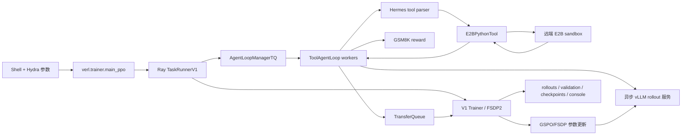
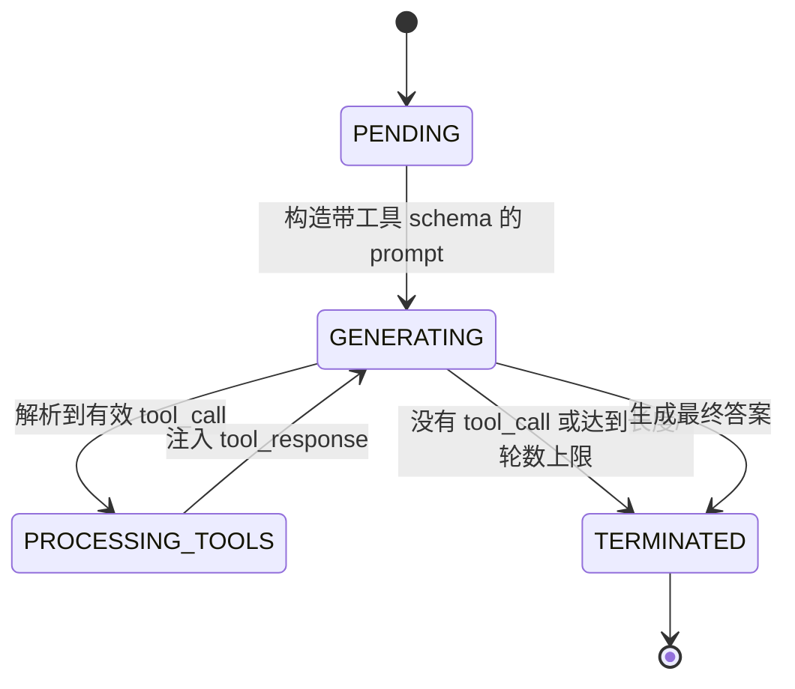
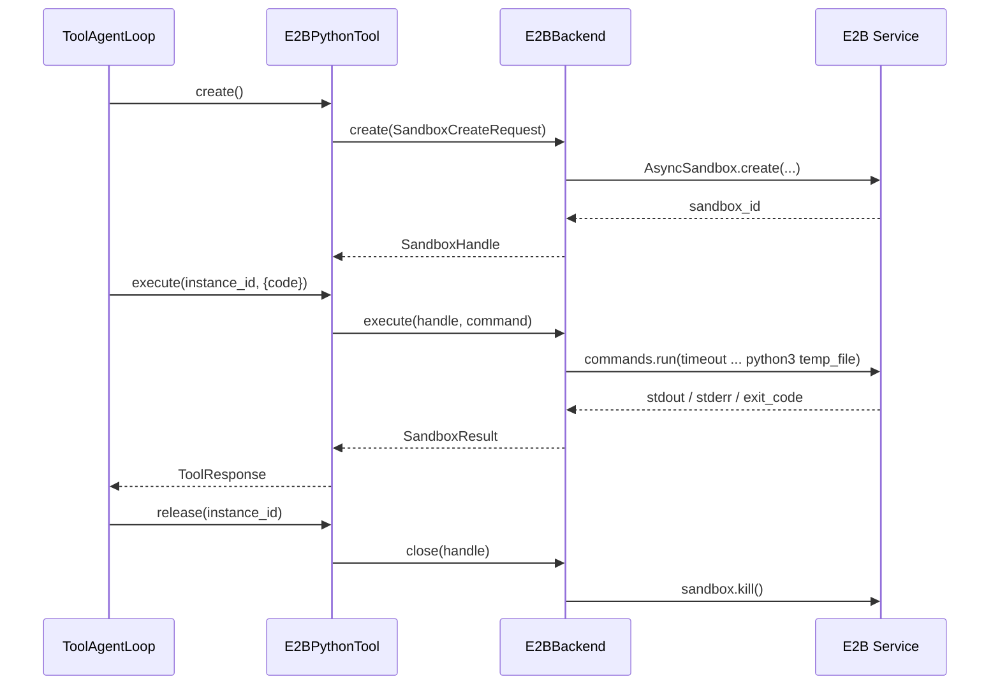

# GSPO + ToolAgentLoop + E2B 训练运行流程

本文说明以下启动方式在 verl V1 trainer 中的实际代码流转：

```bash
TOOL_CONFIG=/root/work/yexuemei/verl/examples/e2b_agent/tool_config.yaml

bash examples/gspo_trainer/run_qwen3_8b_fsdp.sh \
  data.train_files="${TRAIN_FILE}" \
  data.val_files="${VAL_FILE}" \
  data.return_raw_chat=True \
  data.validation_shuffle=False \
  trainer.logger='["console"]' \
  trainer.device=npu \
  trainer.total_training_steps="${TARGET_STEPS}" \
  trainer.val_before_train=False \
  trainer.val_only=False \
  trainer.log_val_generations=8 \
  trainer.test_freq="${VALIDATION_FREQ}" \
  trainer.save_freq="${SAVE_FREQ}" \
  trainer.validation_data_dir="${RUN_ROOT}/validation" \
  trainer.rollout_data_dir="${RUN_ROOT}/rollouts" \
  trainer.default_local_dir="${RUN_ROOT}/checkpoints" \
  actor_rollout_ref.rollout.mode=async \
  actor_rollout_ref.rollout.n=2 \
  actor_rollout_ref.rollout.val_kwargs.n=1 \
  actor_rollout_ref.rollout.val_kwargs.do_sample=False \
  actor_rollout_ref.rollout.val_kwargs.temperature=0 \
  actor_rollout_ref.rollout.multi_turn.enable=True \
  actor_rollout_ref.rollout.multi_turn.format=hermes \
  actor_rollout_ref.rollout.multi_turn.tool_config_path="${TOOL_CONFIG}" \
  actor_rollout_ref.rollout.multi_turn.max_parallel_calls=1 \
  actor_rollout_ref.rollout.multi_turn.max_assistant_turns=2 \
  actor_rollout_ref.rollout.multi_turn.max_tool_response_length=2048 \
  actor_rollout_ref.rollout.agent.default_agent_loop=tool_agent
```

## 1. 总体架构



这里存在两个不同的并发系统：

1. Ray 的 `AgentLoopWorker` 并发，由 `actor_rollout_ref.rollout.agent.num_workers` 控制。
2. 每个 worker 内允许同时存活的 E2B sandbox 数，由 `tool_config.yaml` 的 `max_concurrency` 控制。

若 `num_workers=10` 且 `max_concurrency=1`，全局理论上最多约有 10 个同时存活的 sandbox。E2B P0 实现不是常驻 sandbox：每个工具调用都会执行一次 create → execute → release。

## 2. Shell 参数如何进入训练配置

入口脚本是 `examples/gspo_trainer/run_qwen3_8b_fsdp.sh`。

脚本先根据环境变量构造六组 Hydra 参数：

- `DATA`：数据文件、batch、prompt/response 长度；
- `MODEL`：模型路径、gradient checkpointing；
- `ACTOR`：GSPO loss、学习率、FSDP/offload；
- `ROLLOUT`：vLLM、TP、采样数 `n`；
- `REF`：reference policy；
- `TRAINER`：节点数、每节点设备数、保存和验证频率。

最后执行：

```bash
python3 -m verl.trainer.main_ppo \
  "${DATA[@]}" \
  "${MODEL[@]}" \
  "${ACTOR[@]}" \
  "${ROLLOUT[@]}" \
  "${REF[@]}" \
  "${TRAINER[@]}" \
  "${EXTRA[@]}" \
  "$@"
```

调用方提供的参数位于最后，因此会覆盖入口脚本的默认值。例如入口脚本可能从 `ROLLOUT_N` 生成 `rollout.n=8`，但命令末尾的：

```bash
actor_rollout_ref.rollout.n=2
```

会成为最终生效值。启动日志中打印的 resolved Hydra config 才是判断实际参数的最终依据。

### 关键参数

| 参数 | 作用 |
|---|---|
| `data.return_raw_chat=True` | 数据集返回原始 messages，供 AgentLoop 逐轮追加 assistant/tool 消息。 |
| `rollout.mode=async` | 通过异步 vLLM server/client 生成，而不是在 trainer 内同步调用模型。 |
| `rollout.n=2` | 每条训练 prompt 生成两条独立轨迹。若 train batch 为 8，则每步产生 16 条训练轨迹。 |
| `multi_turn.enable=True` | 启用多轮 Agent 轨迹。 |
| `multi_turn.format=hermes` | 使用 `<tool_call>...</tool_call>` 格式解析模型输出。 |
| `tool_config_path` | 加载 `E2BPythonTool` 类、E2B 后端参数和暴露给模型的 `python` schema。 |
| `max_parallel_calls=1` | 一轮 assistant 即使生成多个工具调用，也只并行执行第一个。 |
| `max_assistant_turns=2` | 最多两次模型生成：通常是“生成工具调用”一次、“读取工具结果后生成最终答案”一次。 |
| `max_tool_response_length=2048` | 工具返回注入模型上下文前最多保留 2048 个字符。 |
| `default_agent_loop=tool_agent` | 数据没有单独指定 `agent_name` 时，统一选择 `ToolAgentLoop`。 |
| `val_kwargs.*` | 只控制验证采样；此处验证为 `n=1`、greedy。 |

## 3. 进程和服务如何启动

`verl.trainer.main_ppo` 完成配置校验后进入 `run_ppo()`：

1. 使用 `ray.init()` 连接当前 Ray 集群；
2. 创建远端 `TaskRunnerV1` actor；
3. 在 `TaskRunnerV1.run()` 中强制启用 TransferQueue；
4. 初始化 V1 trainer；
5. trainer 启动 FSDP actor/reference worker 和异步 vLLM rollout 服务；
6. 创建 `AgentLoopManagerTQ`，并把 trainer 的 vLLM client、reward worker handle 传给它；
7. 调用 `trainer.fit(agent_loop_manager)` 进入训练循环。

Ascend 上入口脚本会设置 HCCL、FSDP2、Ulysses SP、参数 offload 和优化器 offload。HCCL 负责训练 worker 间通信；它与 E2B sandbox 调用是两条独立路径。

## 4. 数据如何变成模型输入

`RLHFDataset` 从 Parquet 中读取样本。训练数据至少需要包含：

- `prompt` 或配置指定的 prompt 字段；
- `data_source`，例如 `openai/gsm8k`；
- reward model 信息中的 `ground_truth`；
- 可选的 `extra_info`、`agent_name` 和 per-sample tool selection。

因为设置了 `data.return_raw_chat=True`，AgentLoop 收到的是类似下面的消息数组，而不是已经拍平的一段字符串：

```json
[
  {"role": "system", "content": "..."},
  {"role": "user", "content": "You must use the provided Python tool..."}
]
```

AgentLoop worker 初始化时通过 `tool_config_path` 加载工具。`tool_config.yaml` 中的 schema：

```yaml
name: python
description: Execute Python code in an isolated sandbox...
parameters:
  type: object
  properties:
    code:
      type: string
```

会随 messages 一起交给 tokenizer/chat template。对 Qwen/Hermes 模板，模型最终看到的提示中会出现工具描述和要求的调用格式。

## 5. 模型如何生成工具调用

每条轨迹由 `ToolAgentLoop.run()` 的状态机驱动：



### 第一次生成

`PENDING` 调用 chat template，把原始 messages 和 `python` 工具 schema 编成 token。随后 `GENERATING` 调用：

```python
await server_manager.generate(
    request_id=...,
    prompt_ids=...,
    sampling_params=...,
)
```

这是真正调用异步 vLLM 模型服务的位置。模型可能输出：

```text
<tool_call>
{"name":"python","arguments":{"code":"print((45 + 15) // 5)"}}
</tool_call>
```

### Hermes 解析

`HermesToolParser` 使用正则提取 `<tool_call>...</tool_call>` 内的 JSON，并生成内部 `FunctionCall`：

```text
name      = python
arguments = {"code":"print((45 + 15) // 5)"}
```

只有同时存在开始和结束标签、内容是合法 JSON、工具名能够匹配 `python` 时，才会进入 `PROCESSING_TOOLS`。模型只在自然语言里说“我会使用 Python”不会启动沙箱。

## 6. Agent 如何创建并执行 E2B sandbox

`PROCESSING_TOOLS` 调用 `ToolAgentLoop._call_tool()`。对 `E2BPythonTool` 这类 `BaseTool`，生命周期固定为：



具体行为如下：

1. `E2BPythonTool.create()` 从环境变量读取的 E2B endpoint/key 已在工具构造时校验；这里向 E2B 服务创建远端 sandbox。
2. `E2BPythonTool.execute()` 读取模型参数中的 `code`。
3. 代码先 base64 编码，再写入 sandbox 临时文件，由 `python3` 执行，避免模型文本被宿主 shell 直接解释。
4. 命令受 `command_timeout_s` 限制。
5. stdout、stderr、退出码被格式化为工具响应。
6. `finally` 中执行 `release()`，调用远端 `sandbox.kill()`；关闭失败时由服务端 TTL 最终回收。

成功响应示例：

```text
<tool_response>
[stdout]
12

[exit_code] 0
</tool_response>
```

看到正常 `<tool_response>` 和 `[exit_code] 0`，表示 sandbox 已成功创建、命令已执行并返回。只有 `<tool_call>` 不能证明 sandbox 创建成功。rollout 文本本身不能证明 `sandbox.kill()` 成功，关闭状态必须看生命周期日志。

## 7. 工具结果如何回到模型

ToolAgentLoop 把 `ToolResponse` 转成 role=`tool` 的消息。工具返回 token 对应的 `response_mask` 为 0，因为它们不是模型采样出的 token，不参与 policy loss。

随后状态机重新进入 `GENERATING`，把此前对话、模型工具调用和工具结果一起发给 vLLM。第二次模型生成最终解释和答案。由于这里配置：

```text
max_assistant_turns=2
```

模型最多有一次生成工具调用、一次根据工具结果生成最终答案的机会。若第一次生成没有合法工具调用，轨迹会直接结束；若第二次仍生成工具调用，也会因为达到 assistant turn 上限而终止，不会再执行下一轮工具。

## 8. Reward 如何计算

AgentLoop 结束后，框架按样本的 `data_source` 选择 reward。`openai/gsm8k` 使用：

```text
verl/utils/reward_score/gsm8k.py
```

reward 从最终模型输出中提取 `####` 后的答案，与 Parquet 中的 `ground_truth` 比较。当前解析器兼容：

```text
#### 12
#### \boxed{12}
#### $\boxed{12}$
```

工具执行成功不等于答案 reward 必然为 1：代码可能算错、模型可能没有正确引用结果、最终格式可能不合法。相反，reward 衡量的是最终答案，不直接奖励“是否调用了工具”。

## 9. 一步训练如何完成

每个 training step 的主要过程是：

1. trainer 取 `train_batch_size` 条 prompt；
2. 每条按 `rollout.n` 展开多条轨迹；
3. AgentLoop worker 并发执行模型生成和 E2B 工具调用；
4. 轨迹、reward、token mask 等写入 TransferQueue；
5. trainer 读取 rollout，计算 old log-prob、advantage 和 GSPO loss；
6. FSDP2 actor 反向传播并更新参数；
7. 新参数同步到 vLLM rollout 服务；
8. 按配置保存 checkpoint、执行验证并输出指标；
9. 将本步轨迹写入 `rollouts/<step>.jsonl`。

若 `train_batch_size=8`、`rollout.n=2`，每步会生成 16 条训练轨迹。`num_workers` 决定这些轨迹由多少 AgentLoop worker 调度，但不会改变轨迹总数。

## 10. 输出到哪里

### Console / `train.log`

`trainer.logger='["console"]'` 会打印每步聚合指标，例如：

```text
actor/loss
actor/grad_norm
critic/rewards/mean
response_length/mean
training/num_turns/mean
timing_s/gen
timing_s/update_actor
timing_s/update_weights
timing_s/step
```

E2B 生命周期 INFO 日志可能位于远端 Ray worker 日志，并不保证全部转发到 driver 的 `train.log`。

### 训练轨迹

```text
${RUN_ROOT}/rollouts/<step>.jsonl
```

每行包含：

```json
{
  "input": "system...user...assistant...",
  "output": "...<tool_call>...<tool_response>...final answer...",
  "gts": "12",
  "score": 1.0,
  "step": 2,
  "uid": "..."
}
```

当前 dump 是拍平文本，因此工具调用位于 `output` 字符串中，不一定存在结构化的 JSON 字段 `tool_calls`。

### 验证轨迹

```text
${RUN_ROOT}/validation/<step>.jsonl
```

只有发生验证时生成。`trainer.val_before_train=False` 关闭训练前验证；`trainer.test_freq<=0` 会关闭周期验证和最后一步验证。若 `test_freq>0`，最后一步仍会验证，即使它不是频率的整数倍。

### Checkpoint

```text
${RUN_ROOT}/checkpoints/global_step_<step>/
```

`trainer.save_freq<=0` 关闭周期和最后一步保存。若 `save_freq>0`，最后一步一定保存。

### 生命周期统计

推荐使用：

```bash
python3 scripts/summarize_e2b_lifecycle.py --run-root "${RUN_ROOT}"
```

它先读取后端生命周期日志；若远端 Ray 日志没有被收集，则从 rollout 中的 `<tool_call>`、`<tool_response>` 和 `[exit_code]` 补充执行统计。sandbox close 不能从 rollout 推断，必须保留为“未观测”而不是假定成功。

## 11. 如何判断各阶段是否成功

| 现象 | 能证明什么 |
|---|---|
| 模型文本说“我要调用 Python” | 什么也不能证明。 |
| 出现合法 `<tool_call>` | 模型提出了工具调用，但不保证 sandbox 已创建。 |
| 出现 `<tool_response>` | Agent 已完成一次工具调用并得到返回。 |
| `<tool_response>` 中 `[exit_code] 0` | sandbox 创建和命令执行成功。 |
| `[exit_code]` 非 0 | sandbox 已运行，但模型生成的代码失败。 |
| `sandbox closed ... success=1` | 远端 sandbox 已主动关闭成功。 |
| `actor/grad_norm > 0` | actor 完成了有效反向传播。 |
| `training/global_step` 达到目标 | 训练循环完成目标步数。 |
| rollout 中 `score=1.0` | 最终答案被 reward 解析并判定正确。 |

端到端成功至少应同时满足：训练退出码为 0、完成目标 step、存在非零梯度、rollout 中存在工具调用和工具返回、至少有一次执行退出码为 0。

## 12. 常见问题

### 有多轮指标，但 E2B 统计为 0

通常是远端 Ray worker 日志没有汇总到 driver。直接检查 rollout 中是否存在 `<tool_call>`、`<tool_response>` 和 `[exit_code]`，并使用生命周期统计器的 rollout fallback。

### 模型生成了工具格式但没有执行

检查：

- 是否同时有 `<tool_call>` 和 `</tool_call>`；
- 标签内部是否为合法 JSON；
- `name` 是否精确等于 `python`；
- `arguments` 是否包含字符串类型的 `code`；
- 是否已经达到 `max_assistant_turns`；
- `python` 是否包含在该样本的 `tool_selection` 中。

### E2B preflight 成功但训练调用失败

preflight 只验证执行它的节点。每个可能承载 AgentLoop worker 的 Ray 节点都必须具有相同的 E2B SDK、环境变量和代码版本。

### 正确答案仍然 score=0

检查最终答案是否包含 `####`，并确认实际运行节点已经同步支持 boxed 格式的 GSM8K reward 解析器。只更新 head 节点而未更新 reward worker 所在节点不会生效。

